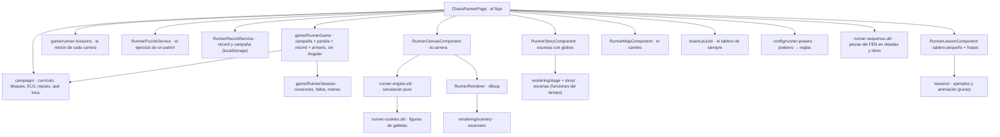

# Flujo del Chess Runner

Un juego de **partidas con historia** que entrena **patrones tácticos** antes de cada ejercicio. Un perrito corre y salta las
piezas del ejercicio; al superarlas aparece el tablero con su reloj. Lo que importa es la táctica: el juego existe para
quitar fricción y para que cada patrón se grabe por **repetición** (los ejercicios de un capítulo son todos del mismo tema),
no para entretener a costa del entrenamiento.

El perrito persigue al **Rey de las Sombras**, que le ha robado el frasco de galletas doradas del reino. Recorre **20 mundos**,
cada uno guardado por una pieza y cada uno con un patrón táctico; en cada uno aprende el patrón (con una lección explicada),
vence al guardián y sube su **ELO**; cada dos capítulos gana un **poder**. Al final recupera el frasco… y empieza otra ronda con
los mismos patrones, más difíciles. **La historia no usa letreros**: se cuenta con imágenes y globos con dibujitos.

> Este documento describe cómo funciona lo implementado. La idea original (planificación) está en
> [`../features/CHESS_RUNNER.md`](../features/CHESS_RUNNER.md).

---

## Qué hace el usuario

Pantalla `/chess-runner` (menú → Práctica → Chess Runner). El control es **uno**: tocar para saltar (Espacio, ↑ o W con
teclado); **dos toques seguidos, doble salto**. Una vuelta del modo es:

**ejercicio nuevo → (historia / camino / lección / poder, solo la primera vez) → carrera de ~25–30 s con su misión → ejercicio
con reloj → resultado (con el ELO) → otra carrera.**

| Con | Qué hace |
|---|---|
| El dedo | **Tocar en cualquier parte de la zona de juego** (no solo el lienzo: el pulgar está abajo). Salta en cuanto se toca |
| El teclado | Espacio, ↑ o W; dos veces seguidas, doble salto |

- **El ejercicio** sale con **60 s** de reloj (**+10 s** si se cumplió la misión de la carrera); la carrera **no descuenta**
  tiempo. Al **resolverlo**: confeti, el ELO sube y, a los 1,6 s, **empieza sola la siguiente carrera** (con el ejercicio ya
  descargado). **Fallarlo o quedarse sin tiempo** no avanza solo: se queda el tablero con «Ver solución», «Ver el patrón» y
  «Otro ejercicio»; **al cerrar la solución el juego sigue**.
- **«Saltar carrera»** va directo al ejercicio, siempre disponible (lo corrido hasta entonces cuenta para la distancia).
- **No toca el ELO del usuario** (el ELO del juego es el del perrito, aparte) y **no crea un `Plan`**. Cada ejercicio cuenta
  para el recordatorio de entrenamiento.
- Las piezas son **las del set que el usuario eligió en Ajustes**, las mismas del tablero.
- En la barra de arriba, siempre: **el ELO del perrito** y, desde el segundo día seguido, **los días jugando** (una llama).

## La campaña de patrones (`campaign/`)

Es lo que hace que el juego sirva para aprender. Una **ronda** son **20 capítulos**, uno por patrón, en un orden de lo más
visual a lo más fino (`runner-curriculum.ts`). Cada dos capítulos el perrito gana un poder:

| # | Patrón | Mundo | Poder |
|---|---|---|---|
| 1 | Pieza colgada | día | – |
| 2 | Mate en 1 | día | olfato |
| 3 | Ataque doble | día | – |
| 4 | Clavada | día | resorte |
| 5 | Pincho | atardecer | – |
| 6 | Mate del pasillo | atardecer | escudo |
| 7 | Ataque a la descubierta | atardecer | – |
| 8 | Capturar al defensor | atardecer | estela |
| 9 | Desviación | noche | – |
| 10 | Atracción | noche | fantasma |
| 11 | Jaque doble | noche | – |
| 12 | Pieza atrapada | noche | esquiva |
| 13 | Ataque por rayos X | niebla | – |
| 14 | Mate árabe | niebla | corazón extra |
| 15 | Mate de Anastasia | niebla | – |
| 16 | Jugada intermedia | amanecer | red |
| 17 | Mate de Boden | amanecer | – |
| 18 | Mate del gancho | amanecer | capa |
| 19 | Mate de la coz | tormenta | – |
| 20 | Mate en 2 | tormenta | corona |

- **Un capítulo = un bloque de 5 ejercicios del mismo tema**. El quinto es **el guardián**: su carrera es más dura (más
  rápida, con más piezas seguidas), el patrón se marca con una calavera y el ELO del ejercicio sale a la vista. **Fallar no
  avanza el bloque** y hace el siguiente algo más fácil (−100 por fallo, hasta −200).
- **El ELO del perrito** (`campaign.rating`) es lo que da la sensación de avance. Empieza **300 por debajo del ELO del usuario**
  (entre 600 y 1500) y se mueve con cada ejercicio con la fórmula del ajedrez (`ratingAfter`, factor K 32 al principio y 24
  después): resolver uno difícil sube mucho; fallar uno fácil baja mucho. El ejercicio de cada puesto se pide a
  `ELO del perrito + desvío` (−200, −120, −40, +40, +140). Se ve en la barra, en el resultado (`+24`) y al perder.
- **Estrellas** por capítulo: 3 sin fallos, 2 con uno, 1 con más.
- **Repaso espaciado**: al cerrar un capítulo (desde el segundo) hay **2 ejercicios del patrón que peor se tiene** de los ya
  aprendidos (más fallados y más tiempo sin verse). Es lo único que cambia de tema en mitad de la campaña, y va entre
  capítulos, no entre ejercicios.
- **Rondas**: al vencer al rey empieza otra con los mismos 20 patrones (el nivel de la carrera sigue subiendo con los
  capítulos vencidos, el ELO también). El final de la historia sale una sola vez.
- **Se guarda** (`RunnerRecordService`, `localStorage`, sin sincronizar con el perfil): ronda y capítulo, bloque, ELO (y su
  máximo), lo acertado y fallado de cada patrón, poderes, estrellas, repaso pendiente, lo visto de la historia y las lecciones,
  las galletas guardadas, el pelaje del perrito y los días seguidos. Un dato roto o de otra versión se descarta y se parte de
  una campaña nueva (`sanitizeCampaign`; la versión actual es la 2).
- Una **partida** (corazones, fallos, distancia) es aparte de la campaña: al perder se vuelve a empezar la partida **pero la
  campaña sigue donde iba**.

El servicio del catálogo (`RunnerPuzzleService.next`) acepta un `theme` fijo: con él pide siempre ese patrón (y, si no hay
ejercicios nuevos, el mismo patrón algo más fácil y más difícil, nunca otro tema).

## La historia, sin letreros (`story/`, `rendering/stage.ts`)

Cuatro escenas, cada una una **función pura del tiempo** (`StoryScene.frame(t, ancho)` devuelve un `StageFrame`: mundo,
perrito, objetos —con **globos de dibujitos**—, oscurecido y destello) que `RunnerStoryComponent` reproduce en un lienzo del
tamaño del de la carrera. Todas se saltan tocando.

1. **Prólogo** (~8 s, solo la primera vez de la vida): el perrito duerme junto al frasco y sueña con galletas (un globo con
   galleta y corazón); llega el Rey de las Sombras (la pieza negra del set, teñida de violeta, con ojos rojos) con un globo
   del frasco, se lo lleva y deja una estela de galletas; el perrito despierta (alerta), un globo con una lágrima y el frasco
   dice que lo echa en falta, y otro con fuego y el rey, que va a por él.
2. **El camino hasta el frasco** (tarjeta tras el prólogo): el mapa con los 20 guardianes, sus patrones y los poderes que dan.
3. **Llegada a un mundo** (~4 s, una vez por capítulo): el ladrón cruza el fondo con el frasco (globo con frasco y flecha); de
   la nada sube el guardián (más grande según se avanza, `guardianScale`); el perrito frena y se pone en guardia (fuego).
4. **Victoria** (~6 s, al cerrar un capítulo): el guardián tiembla, destella y se deshace en galletas; si trae poder, vuela
   hasta el perrito y salen las estrellas. **Si el poder es nuevo, una tarjeta** enseña su icono, su nombre y lo que hace.
5. **Final** (~10 s, al cerrar el último de la primera ronda): el perrito, con todo su equipo, salta (dos veces) contra el rey
   gigante; este se encoge y se deshace, el frasco vuelve a su peldaño, **amanece**, llueven galletas y un globo celebra el
   frasco y el corazón.

El perrito **cambia de aspecto con cada poder** (`rendering/dog-gear.ts`): muelles en las patas, bufanda roja, venda verde,
cascabel, corazón en el pecho, ojos cian, capa violeta, corona dorada, brillo en el hocico y una burbuja azul con el escudo.

## Las lecciones (`lessons/`)

La primera vez que se entrena un patrón (y la primera vez que se repasa), antes de correr sale la **lección**: un tablero
pequeño de 8×8 con las piezas del set del usuario donde se hace un ejemplo mínimo del patrón. **Se explica con frases cortas**
(al estilo de las prácticas de Lichess; `CHESS_RUNNER.lessons.<patrón>`):

- **la idea**, siempre arriba (qué es el patrón en una frase);
- **qué mirar** (la posición quieta, con lo importante señalado), **qué se juega** (cada jugada se desliza y se deja leer),
  **por qué funciona** (el resultado iluminado, con flechas) y, al acabar, **cómo reconocerlo**.

Dura 8–14 s y **no avanza sola**: se queda hasta que el usuario pulsa «Empezar» (el botón late al acabar). Al acabar sale
**«Pruébalo tú»**: el tablero vuelve a la posición inicial y el usuario hace la primera jugada (toca la pieza y su casilla); si
acierta, la lección sigue desde esa jugada; si no, el tablero se enrojece un instante y se le dice que lo intente otra vez
(aprender haciendo, como en las prácticas de Lichess). Tras **fallar** un ejercicio, «Ver el patrón» la repite en una ventana.

Cada lección (`runner-lessons.data.ts`) es un FEN y unas jugadas en UCI **comprobadas con `chess.js` en las pruebas**
(legales, y con el patrón que dicen enseñar: el ataque doble ataca a dos piezas, la clavada deja al caballo sin jugadas legales,
los mates son mate, el defensor capturado deja el peón sin recapturar…). La animación es pura (`lessonFrame(lección, t)` dice
dónde está cada pieza, qué brilla, qué flecha se dibuja y **qué tramo se explica**). Los ejemplos de capturar al defensor, la
desviación, la atracción, los rayos X y la jugada intermedia salen de puzzles reales de Lichess, simplificados.

## La carrera (`utils/runner-sequence.util.ts`)

Dura **~25–32 s** (25 s en el nivel 1, +0,35 s por nivel; las pruebas simulan carreras enteras y miden que dura lo que toca).
Se arma en **oleadas** con un **respiro de galletas** entre una y otra:

1. **Presentación**: cada tipo de pieza del ejercicio una vez, de la más baja a la más alta.
2. **Desfile**: todas las piezas, mezcladas con la semilla del ejercicio.
3. **Desafío**: todas, de la más alta a la más baja, con el suelo ya a tope.

El largo se ajusta quitando del final (o repitiendo, si el ejercicio tiene pocas piezas). Salen **hasta 2 de cada tipo** del FEN
y hasta 8 distintas; un tablero sin piezas va directo al ejercicio.

**El ritmo no es un metrónomo** (`beatFor`, `tightShare`): cada pieza deja un hueco encadenado (el mínimo), normal o un respiro
largo. Al empezar solo el 12 % va encadenado y sube hasta la mitad según el nivel; es lo que hace que el reto se note.
**Contra el guardián** la carrera sube dos niveles de dificultad.

### Falanges y doble salto

Desde el nivel 2 salen **falanges**: tres piezas iguales en fila, separadas lo justo (`wallSpacing`, según la velocidad)
para que **un salto sencillo no pueda pasar por encima de todas** y uno doble sí. Una en los niveles 2–4, dos en 5–7, tres en
8–11 y cuatro desde el 12; nunca la primera pieza ni las que se deslizan. **La primera vez que está por salir una, un aviso
explica el doble salto** (justo antes, no al empezar). Sobre cada falange van las galletas más altas (solo con el doble salto).

### Cómo se mueve cada pieza (`PIECE_BEHAVIOR`)

Lo que cambia es **lo que se ve venir**, no cuándo hay que saltar: todas parten de un `plan` común (donde estaría si fuera
quieta) y coinciden con él al llegar.

| Pieza | Qué hace | Qué pide |
|---|---|---|
| Peón | Quieto | El salto básico |
| Torre | **Se desliza** 1,5× más rápido que el suelo y aparece de golpe, con estela | Reaccionar |
| Alfil | **Flota** unos 8 px sobre el suelo | Estar en lo alto del salto al pasar |
| Caballo | **Salto en L**: poco antes de llegar avanza de golpe 28 px y se eleva | No adelantarse |
| Dama | Se desliza (1,3×) **y** salta en L | Las dos cosas |
| Rey | Quieto, el más alto | El margen más corto |

### Galletas, saltos perfectos y la estrella

- **Galletas con figura** (`utils/runner-cookies.util.ts`): sobre cada pieza sale una de cinco figuras (arco, cresta, rampa,
  bajada, alta); a ras de suelo en el hueco, una de cuatro (fila, ola, escalera, par); en un hueco largo, a veces **galletas
  golosas** en el aire que piden un salto de más; y la **cinta del respiro** tiene cuatro formas (arco, olas, escalera,
  zigzag). La figura sale del ritmo y del número de la pieza: la misma carrera da las mismas galletas.
- **Salto perfecto**: si la pieza pasa justo cuando el perrito está en lo más alto del salto (≥95 % de la altura; en una falange,
  de la del segundo salto) sale «¡Perfecto!», una chispa y **+3 galletas**. Es lo que premia dominar el ritmo.
- **La estrella** (una por carrera, en el primer respiro, a una altura que un salto normal alcanza): **4 s imparable**; el
  perrito arrolla las piezas que toca (cuentan como superadas, **+2 galletas** cada una) con un resplandor dorado que parpadea
  al acabarse.
- **Misión de la carrera** (`game/runner-missions.ts`): un reto corto en una esquina del lienzo (perfectos, galletas, una
  racha, coger la estrella o no chocar; los difíciles solo desde los niveles 3 y 5, y los objetivos suben con el nivel).
  Cumplida, **+10 s de reloj para el ejercicio**: lo que se hace bien corriendo ayuda a la táctica.
- **60** galletas devuelven un corazón (40 con la red). Un choque **hace saltar hasta 8** de las que se llevaban hacia el
  próximo corazón (salen volando, como los anillos de Sonic).

## La partida (`game/runner-session.ts`, dirigida por `game/runner-game.ts`)

`RunnerGame` reúne campaña, partida y récord: la pantalla solo decide qué se ve y cuándo; qué cambia con cada ejercicio
(`recordSolved`/`recordFailed`), cada poder ganado y cada carrera (`bank`) está ahí y se prueba sin Angular.

- **3 corazones** (4 con el poder del corazón): cada choque cuesta uno; sin ninguno se acaba la partida **en el acto**.
  Resolver un ejercicio **cura uno** (dos con la corona); 60 galletas, otro.
- **3 ejercicios fallidos** (también cuenta quedarse sin tiempo): con el tercero solo se puede ver la solución y terminar.
- **Récord de distancia**, como el dinosaurio de Chrome: se corren **metros** (8 px de carrera = 1 m) y se acumulan a lo largo
  de toda la partida. El mejor se guarda; **al pasarlo sale un aviso** («¡Récord superado!», una vez por partida).
- **Las galletas se guardan** (la cartera) y compran **pelajes del perrito** en el **armario** (pantalla de fin): chocolate
  (el de siempre), dorado, nieve, noche, fresa y cielo, de 300 a 3200 galletas. No hay imágenes nuevas: cada pelaje es una tabla
  de colores que se aplica a las hojas de sprites (`rendering/dog-skins.ts`).
- **Días seguidos**: resolver un ejercicio cuenta como jugar hoy; con días consecutivos la racha sube (una llama en la barra).
- **Pantalla de fin**: distancia y récord, capítulo (y ronda), ELO (con lo ganado), resueltos y galletas, «Jugar otra vez», el
  camino de los guardianes (**nombre de cada patrón, estrellas, el poder de cada uno, una barrita con lo que se acierta**),
  la lista de poderes con lo que hace cada uno y el armario.
- **La equis y el panel**: la equis de la barra, a mitad de partida, lleva al **panel** (lo corrido queda guardado); desde el panel, al
  inicio. Quien ya ha jugado, al volver a entrar ve ese mismo panel (con «Jugar») en vez de caer en una partida; la primera vez va
  directo al juego.
- **La racha** (piezas seguidas sin chocar) se enciende a partir de tres.

## Los poderes (`config/runner-powers.ts`)

Pasivos (el control sigue siendo uno): ayudan, no se pueden desactivar y no cambian lo que hay que hacer. `modifiersFor(poderes)`
los convierte en las reglas de la carrera (`RunnerModifiers`). Un poder ganado cuenta **ya** en la partida en curso.

| Poder | Qué hace |
|---|---|
| Olfato | Las galletas se cogen desde más lejos |
| Resorte | El segundo salto sube más (las falanges dejan más margen) |
| Escudo | Aguanta el primer choque de cada carrera |
| Estela | Un destello bajo las patas marca el momento de tocar |
| Fantasma | Se ve dónde llegará de verdad cada pieza que se desliza o salta |
| Esquiva | Tras un choque, a salvo el doble de tiempo |
| Corazón extra | Cuatro corazones |
| Red | 40 galletas por corazón en vez de 60 |
| Capa | Un toque dado antes de aterrizar se guarda más tiempo |
| Corona | Resolver un ejercicio cura dos corazones |

Cuando se gana uno **sale una tarjeta** con su icono grande, su nombre y lo que hace; después se pueden repasar en la pantalla
de fin.

## El motor (`utils/runner-engine.util.ts`)

Una **simulación pura**: `stepRun(estado, dt)` avanza un instante y devuelve el estado nuevo y lo que ocurrió; `jump(estado)`
ejecuta un toque. No sabe de canvas ni de reloj, así que se prueba con carreras guionizadas. Corre a un **paso fijo de 1/120 s**.

- Coordenadas en **píxeles lógicos**; `y` es la altura sobre el suelo. Es el suelo el que pasa (de 120 px/s en el nivel 1 a
  ~204 px/s en el 20, con subida suave dentro de cada carrera; del nivel 10 al 20 la dificultad sube a la mitad de ritmo).
- **Salto**: sube ~62 px y dura ~0,78 s (**flotante a propósito**, para dejar tiempo de acertar). **Doble salto**: un segundo
  impulso que lleva a ~110 px; si el segundo toque se da subiendo, **espera a la cima**, así que dos toques rápidos siempre salen
  bien. No hay triple. Un toque dado justo antes de aterrizar se guarda y se hace al tocar el suelo.
- **Cajas indulgentes**: lo que puede chocar es menor que el dibujo, del perrito (16×24) y de las piezas.
- Entre piezas hay un **hueco medido en tiempo** (1,12–1,97 s en el nivel 1, con suelo de 0,95 s a partir del nivel 9), no en
  píxeles: el ritmo se mantiene aunque el suelo acelere, y el mínimo de cualquier nivel deja tiempo de aterrizar y volver a saltar.

### Equilibrio

Las medidas están fijadas por pruebas que **barren el instante del toque y miden la ventana de acierto**:

| Pieza | Choca (ancho × alto) | Margen para acertar (nivel 1) |
|---|---|---|
| Peón | 8 × 11 | ~0,51 s |
| Torre | 10 × 15 | ~0,54 s (se desliza) |
| Alfil | 10 × 15, flotando 8 | ~0,41 s |
| Caballo | 12 × 18 | ~0,43 s |
| Dama | 10 × 21 | ~0,48 s |
| Rey | 10 × 23 | ~0,41 s |
| Falange (con doble salto) | 3 piezas | ~0,30 s (con un salto sencillo, nunca) |

Y por pruebas que simulan **jugadores con ruido** (`runner-balance.spec.ts`): un jugador fino (σ 0,05 s) casi no choca; uno
normal (σ 0,09 s) sufre menos de 0,6 choques por carrera al empezar y menos de 1,5 en el nivel 10; uno despistado (σ 0,12 s)
menos de 2. Nadie pierde sus tres corazones antes de llegar al ejercicio, y quien toca sin criterio sí choca mucho (no es
trivial). Si cambias una medida y una de estas pruebas falla, el juego se ha vuelto injusto o trivial. El salto perfecto es
la franja del centro de la ventana (entre el 12 % y el 50 % de ella), y la estrella solo cambia lo que ocurre al chocar.

## Dibujo (`rendering/`, `components/`)

- `scenery.ts`: cielo, astro de cada mundo, nubes, horizonte de piezas gigantes, colinas, el tono del mundo, estrellas,
  niebla, lluvia con relámpagos y el suelo de tablero. Lo comparten la carrera y las escenas.
- `pixel-art.ts` (galleta, la estrella del poder, frasco, peldaño, alerta, estrella de capítulo y los **dibujitos de los
  globos**), `power-icons.ts` (un icono por poder), `dog-gear.ts` (el equipo), `dog-skins.ts` (los pelajes),
  `stage.ts` (un fotograma de escena, con los globos). Todo **dibujado con código**: no hay archivos de imagen nuevos.
- `RunnerCanvasComponent` (la carrera, con textos que suben, galletas que vuelan y el resplandor de la estrella),
  `RunnerLessonComponent` (el tablero pequeño y sus frases), `RunnerStoryComponent` (las escenas),
  `RunnerMapComponent` (el camino, en el DOM) y `RunnerLessonModalComponent` (la lección en una ventana).
- Los canvas usan una **escala entera** (`round(ancho / 220)`) para que el pixel art no admita fracciones, y en pantallas de
  alta densidad se dibujan a resolución nativa. El bucle corre **fuera de la zona de Angular**.

## ¿Cómo está montado?

## Analítica

`chess_runner_started` (`obstacles`, `level`), `chess_runner_finished` (`obstacles`, `stumbles`, `clean`, `duration_ms`,
`meters`, `cookies`, `hearts`, `best_combo`, `level`, `skipped`), `chess_runner_game_over` (`reason`: `hits` o `strikes`,
`meters`, `level`, `solved`, `cookies`, `new_record`) y `chess_runner_skin` (`skin`, `action`). El ejercicio emite
`puzzle_started` y `puzzle_completed` con `routine_kind: 'runner'`.

## Ideas tomadas de otros juegos (solo mecánicas, sin copiar arte ni marcas)

| Juego / género | Qué se tomó |
|---|---|
| Dinosaurio de Chrome | Un solo control, récord de distancia, el suelo que acelera |
| Geometry Dash, Subway Surfers | Salto perfecto con premio, la barra de progreso de la carrera |
| Sonic | Las galletas que se llevan salen volando al chocar |
| Super Mario | La estrella: imparable unos segundos, arrollas lo que toques |
| Cuphead, Mega Man | Un guardián al final de cada mundo, más duro que los demás |
| Jetpack Joyride | Una misión corta por carrera con premio |
| Crossy Road | Pelajes que se compran con lo que se recoge |
| Duolingo | Días seguidos, ELO propio, repaso espaciado de lo que peor se sabe |
| Candy Crush | Camino de niveles con estrellas |

## Decisiones tomadas

1. **Motor propio en canvas 2D, no Phaser.** Una simulación pura, probada sin dibujar nada, evita ~1 MB de dependencia.
2. **Un solo control.** La primera versión pedía seis mecánicas y era difícil de recordar. Ahora todo es saltar (y el doble
   salto, dos toques que no pueden salir mal); la variedad está en cómo se mueve cada pieza, no en qué hay que pulsar.
3. **El tema no cambia de un ejercicio a otro.** Un capítulo son 5 ejercicios del mismo patrón con la dificultad subiendo; solo
   cambia al terminar, y entre capítulos hay un repaso del patrón más flojo (espaciado, no mezclado).
4. **La historia no usa letreros.** Se entiende con dibujos y globos con dibujitos; el texto es el nombre del patrón (para
   aprender), las frases de las lecciones y la interfaz.
5. **El ELO del perrito es propio**, no el del usuario: el runner es calentamiento, no un test. Pero se calcula como el de
   ajedrez, para que el avance se sienta de verdad.
6. **Se puede perder** (corazones y fallos), pero con ventanas de acierto anchas y corazones que se recuperan: un juego
   injusto aleja del entrenamiento. Medido con jugadores simulados (ver Equilibrio).
7. **Los poderes ayudan, no dan trucos**, y cada uno se explica al ganarlo.
8. **La carrera no descuenta tiempo** del ejercicio: 60 s fijos (más si se cumple la misión). **Resolver encadena la siguiente
   carrera sin botón.**
9. **Piezas del set del usuario** (coherencia con el tablero); los guardianes y el rey de las sombras son esas mismas piezas teñidas.
10. **Todo el arte nuevo es código** (píxeles dibujados y tablas de colores), no archivos.
11. **Sin final**: al vencer al rey empieza otra ronda con los mismos patrones; el repaso y el ELO hacen que no sea lo mismo.

### Probado y descartado

- **Un control por pieza** (agacharse, salto largo, mantener…): difícil de recordar. Se queda en un toque.
- **Piezas que vuelven tras un choque** (reintento): con corazones, un choque es un choque.
- **Un tema al azar en cada ejercicio**: dilución del patrón (ver 3).
- **Diez capítulos y se acaba**: el avance se agotaba enseguida y no había sensación de progreso en el ELO; ahora 20 capítulos,
  rondas y un ELO propio.
- **Ejercicios relativos al ELO del usuario**: el ejercicio de cada puesto no cambiaba nunca; con el ELO del perrito (que
  sube y baja) sí.
- **Una lección sin texto que avanza sola**: no daba tiempo de entender qué se miraba; ahora la idea, las frases y un
  botón «Empezar».
- **Galletas siempre en el mismo sitio**: se aprendían de memoria; ahora figuras que salen del ritmo de cada pieza.
- **Ritmo con huecos casi iguales** (1,3–1,65 s): se sentía igual en todos los niveles; ahora hay piezas encadenadas, normales
  y respiros largos, y las encadenadas crecen con el nivel.
- **Precios de pelajes de 150 a 1200 galletas**: con ~100 galletas por carrera se desbloqueaban todos en minutos.
- **Aviso del doble salto al empezar la carrera**: la primera falange queda lejos; sale justo antes de ella.
- **Miniaturas de las piezas por superar**: con 15–25 piezas por carrera no cabían; las sustituye una barra de progreso con
  una marca en cada respiro.
- **Teñir con `ctx.filter`**: no existe en Safari; el rey de las sombras se tiñe con una copia en un lienzo aparte.
- **Que el poder de la huella marque un punto fijo en el suelo**: engañaba con las piezas que se deslizan; se calcula con la
  hora de llegada real.
- **Un ejemplo de «capturar al defensor» con una torre y jaque con el alfil**: el caballo estaba clavado, no «defendía»; se
  cambió por el peón de e5 protegido por el caballo de c6.

## Límites conocidos

- Solo está en el menú: no hay tarjeta en el inicio ni se puede activar delante de las rutinas.
- El progreso (campaña, galletas, pelajes, días) es **del dispositivo**: no sincroniza con el perfil; borrar los datos o
  cambiar de móvil lo pierde.
- Pasado el nivel 20 la velocidad y el ritmo ya no suben (siguen las falanges y el ELO).
- Los sonidos son los generales de la app; no hay uno propio por pieza ni música.
- El runner no respeta (todavía) un ajuste de «menos movimiento» del sistema.
- Las lecciones son veinte ejemplos hechos a mano (uno por patrón del juego); los demás temas del catálogo no tienen lección.
- El juego no se ha probado con jugadores reales: el equilibrio sale de simulaciones.

## Pruebas

- Unitarias en [`tests/unit/features/chess-runner/`](../../apps/chessColate/tests/unit/features/chess-runner/): el motor (física,
  ventanas de acierto, doble salto, falanges, movimiento de cada pieza, galletas y sus figuras, saltos perfectos, estrella,
  poderes), el **equilibrio con jugadores simulados**, la secuencia en oleadas y su ritmo, la campaña (currículo, bloques, ELO,
  rondas, repaso, estrellas, días seguidos, datos rotos), el decisor de lo que se enseña antes de correr, las lecciones (con
  `chess.js` y con sus frases en los dos idiomas), las escenas y sus globos, el dibujo (escenario, píxeles, equipo, pelajes,
  escena) con un canvas simulado, los componentes (carrera, lección, escena, mapa, ventana), la partida (corazones, galletas,
  armario, días) y la pantalla (el flujo historia → camino → lección → carrera → ejercicio → victoria → poder, misiones, ELO,
  récord, armario).
- Python: [`test_runner_assets.py`](../../tools/stream-assets/test_runner_assets.py) (`./.venv/bin/python -m unittest`).
- E2E en [`specs/chess-runner.spec.ts`](../../apps/chessColate-e2e/specs/chess-runner.spec.ts): una captura de la pantalla, el
  prólogo, el camino y la lección (con sus frases), una carrera completa jugada con el teclado (y que dura lo que toca), otra
  sin tocar nada (fin de partida con récord y mapa de 20), el doble salto, toques reales (CDP), los poderes, resolver un
  ejercicio (que avanza el bloque), cerrar un capítulo (victoria, tarjeta del poder y ELO), el armario, fallar (y ver el
  patrón) y el agotamiento del catálogo.
