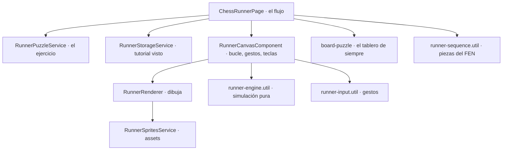

# Flujo del Chess Runner

Un calentamiento previo a cada ejercicio: **Chocolate, la mascota, corre** y las **piezas del ejercicio son
los obstáculos**. Cada pieza se esquiva de una forma distinta. Al superarlas aparece el tablero con su
reloj y se resuelve el ejercicio de siempre. Gamifica el acceso al ejercicio y familiariza con las piezas
que van a intervenir.

> Este documento describe cómo funciona lo implementado. La idea original (planificación) está en
> [`../features/CHESS_RUNNER.md`](../features/CHESS_RUNNER.md).

---

## Qué hace el usuario

Pantalla `/chess-runner` (menú → Práctica → Chess Runner). Cada vuelta del modo es: **buscar un ejercicio →
carrera → ejercicio con reloj → resultado → otro**.

| Pieza | Qué pide | Con el dedo | Con el teclado |
|---|---|---|---|
| **Peón** | Un salto normal | Tocar | Espacio, ↑ o W |
| **Torre** | Vuela baja: pasar agachado | Deslizar hacia abajo | ↓ o S |
| **Alfil** | Son tres seguidos: salto largo | Deslizar arriba y a la derecha | → o D |
| **Caballo** | Alto y ancho: saltar y mantener para quedarse en el aire | Tocar y mantener pulsado | Mantener Espacio |
| **Dama** | Más alta que un salto: doble salto | Tocar dos veces | Pulsar dos veces |
| **Rey** | Un salto en el momento justo; un aro ilumina el instante | Tocar | Espacio |

- **Cualquier parte de la zona de juego vale** para tocar o deslizar (no solo el lienzo): el pulgar está abajo.
- **Cada obstáculo lleva una flecha de pista** (iconos del mismo juego de assets).
- **Tropezar no es castigo**: Chocolate se queda aturdido (parpadea, 0,9 s sin poder chocar) y **la misma pieza
  reaparece una vez más**. Tras un segundo tropiezo con ella, la carrera sigue. Nunca se queda atascada.
- **La primera vez** se enseña un tutorial con las seis piezas y lo que pide cada una (`chessColate_runner_tutorial_seen`).
- **«Saltar carrera»** va directo al ejercicio, siempre disponible.
- **El ejercicio** sale con **60 s** de reloj. La carrera **no descuenta** tiempo del ejercicio (decisión de diseño:
  es un calentamiento, no una penalización).
- **No toca el ELO** del usuario y **no crea un `Plan`** (como la Racha). Cada ejercicio cuenta para el recordatorio
  de entrenamiento.
- **Resultado**: resuelto, fallado (con «Ver solución») o sin tiempo; «Otro ejercicio» sigue. El contador
  «Resueltos» es de la sesión.

## Las piezas de la carrera

Salen del FEN del ejercicio (`utils/runner-sequence.util.ts`):

1. De cada tipo salen **hasta 2** (alternando bandos si hay de los dos).
2. Máximo **8 obstáculos**. Si hay más se quita el segundo ejemplar de los tipos **más duros primero** (dos damas
   o dos reyes seguidos son un castigo, no un reto), sin dejar nunca un tipo sin representar.
3. El orden se mezcla con una **semilla del ejercicio** (determinista: el mismo ejercicio da la misma carrera) y
   **empieza por un peón** si lo hay.
4. Un tablero sin piezas no tiene carrera: va directo al ejercicio.

## El motor (`utils/runner-engine.util.ts`)

Una **simulación pura**: `stepRun(estado, dt, manteniendo)` avanza un instante y devuelve el estado nuevo y lo que
ocurrió; `perform(estado, orden)` ejecuta una orden. No sabe de canvas ni de reloj, así que se prueba con
carreras guionizadas. Corre a un **paso fijo de 1/120 s**, y los números del juego se afinaron con él.

- Coordenadas en **píxeles lógicos**; `y` es la altura sobre el suelo. Es el suelo el que pasa (130 px/s);
  Chocolate corre en el sitio.
- **Salto**: sube unos 52 px y dura ~0,68 s. **Mantener** en la cima suspende hasta 0,35 s. **Doble salto**:
  segundo impulso en el aire. **Salto largo**: el suelo pasa 1,9× más rápido mientras dura el vuelo.
- **Agacharse** 0,6 s; la caja que puede chocar baja de 26 a 11 px. En el aire, agacharse es caer en picado y
  al aterrizar queda agachado.
- **Buffer de entrada**: una orden que no se puede cumplir ahora (en el aire) se guarda 0,12 s y se hace al
  aterrizar.
- **Cajas indulgentes**: lo que puede chocar es menor que el dibujo, de Chocolate y de las piezas.

### Equilibrio

Las medidas de cada pieza (`config/runner.config.ts`) están fijadas por pruebas que **barren el instante de la
pulsación y miden la ventana de acierto** (`tests/unit/features/chess-runner/utils/runner-engine.util.spec.ts`):

| Pieza | Margen para acertar | Qué falla |
|---|---|---|
| Peón | ~0,29 s | agacharse |
| Torre | ~0,31 s | saltar, salto largo |
| Alfil | ~0,45 s | saltar, agacharse |
| Caballo | ~0,35 s | saltar sin mantener, agacharse |
| Dama | ~0,26 s | un solo salto, salto largo |
| Rey | ~0,13 s (el más preciso) | agacharse |

Cada mecánica equivocada **nunca** supera su pieza, sin hacer nada **siempre** se tropieza, y un jugador que
hace lo que pide cada pieza pasa una carrera de seis sin tropezar (prueba con un «bot» que decide por distancia).
Si cambias una medida y una de estas pruebas falla, el juego se ha vuelto injusto o trivial.

## Gestos (`utils/runner-input.util.ts` y el lienzo)

Un toque se decide tras **55 ms**, para distinguir tocar de empezar a deslizar. Si el dedo ya se movió más de 5 px,
se espera un poco más (hasta 180 ms) a ver si llega a deslizar: un deslizamiento lento no debe tomarse por un toque.
Deslizar hacia abajo (16 px) agacha; arriba y a la derecha, salto largo. **Mantener pulsado más allá de los 55 ms**
es lo que hace flotar. Los botones de la pantalla siguen siendo botones.

## Dibujo y escala

`components/runner-canvas/` pinta con un lienzo 2D. Todo en píxeles lógicos y a una **escala entera** (el pixel art no
admite fracciones): `round(ancho / 220)`, así el ancho lógico queda entre 165 y 275 px y el alto es siempre 176.
En pantallas de alta densidad el lienzo se dibuja a resolución nativa sin cambiar el tamaño en pantalla. El
bucle corre **fuera de la zona de Angular** y solo entra en ella cuando hay algo que contar; con un paso fijo y un
tope por fotograma, una pestaña dormida no se «pone al día» de golpe.

`runner-renderer.ts` no sabe de Angular: recibe el estado y dibuja cielo, nubes y colinas con paralaje, el suelo de
tablero, las sombras, los obstáculos, a Chocolate (animación según lo que hace) y las pistas.

## Los assets

Pixel art generado por código, determinista y verificable, en el pipeline que ya existía para el directo 24/7:
[`tools/stream-assets/`](../../tools/stream-assets/README.md) (`runner.py`, `export_runner.py`). Salen a
[`assets/images/runner/`](../../apps/chessColate/src/assets/images/runner/) con un `runner.json` que describe cada tira.

- **Chocolate** (el mismo cuerpo y paleta que en el directo): correr (4 cuadros), saltar (subir, cima, bajar),
  agacharse, tropezar y contento.
- **Las 6 piezas en los dos bandos**: la torre «flota», el alfil es un trío, el caballo y la dama son más grandes.
- **Iconos de pista**, y los **tiles** del suelo (un tablero), colinas, cielo y nubes.

`export_runner.py --check` comprueba píxel a píxel que lo versionado coincide con lo que generan los scripts.

## ¿Cómo está montado?

Todo en [`features/chess-runner/`](../../apps/chessColate/src/app/features/chess-runner/). El ejercicio sale del catálogo
(`RunnerPuzzleService`: un tema táctico al azar, cerca del ELO del usuario, sin repetir en la sesión) y el
**siguiente se precarga** mientras se resuelve el actual; si la precarga falló se reintenta antes de dar error.

## Analítica

`chess_runner_started` (`obstacles`) y `chess_runner_finished` (`obstacles`, `stumbles`, `clean`, `duration_ms`,
`skipped`). El ejercicio emite `puzzle_started` y `puzzle_completed` con `routine_kind: 'runner'`.

## Decisiones tomadas

Las del diseño original que quedaban abiertas:

1. **Motor propio en canvas 2D, no Phaser.** El runner necesita un salto, una colisión y seis mecánicas: una
   simulación pura de ~250 líneas, probada sin dibujar nada, evita ~1 MB de dependencia, la integración con la zona
   de Angular y un motor que no se puede probar con Jest. (Esto es lo que más se aparta del documento original.)
2. **La carrera no descuenta tiempo** del ejercicio: 60 s fijos.
3. **Tutorial** la primera vez; las pistas siempre a la vista.
4. **Modo propio, no un interruptor en las rutinas**: se juega desde el menú y no cambia las rutinas existentes.
   Meterlo delante de cada ejercicio de las rutinas queda como posible segunda fase.
5. **Piezas**: los assets son pixel art nuevo (los SVG de cm-chessboard no encajan con el estilo de Chocolate).
6. **Sonido**: se reutilizan los sonidos de la app (no hay audio nuevo).

## Límites conocidos

- Solo está en el menú: no hay tarjeta en el inicio ni se puede activar delante de las rutinas.
- No hay récord ni estadísticas guardadas (solo el contador de la sesión y el tutorial visto).
- Los sonidos son los generales de la app; no hay uno propio por pieza.
- El runner no respeta (todavía) un ajuste de «menos movimiento» del sistema.

## Pruebas

- Unitarias en [`tests/unit/features/chess-runner/`](../../apps/chessColate/tests/unit/features/chess-runner/): el motor (física,
  ventanas de acierto por pieza, mecánicas equivocadas, reintento, buffer), la secuencia desde el FEN, los gestos y
  las teclas, el lienzo con un canvas simulado, los servicios, la pantalla y un cruce de assets y traducciones.
- Python: [`test_runner_assets.py`](../../tools/stream-assets/test_runner_assets.py) (`./.venv/bin/python -m unittest`).
- E2E en [`specs/chess-runner.spec.ts`](../../apps/chessColate-e2e/specs/chess-runner.spec.ts): tutorial una sola vez, una
  carrera completa jugada con el teclado sin tropezar, otra sin tocar nada, gestos táctiles reales (CDP), resolver y
  fallar el ejercicio y el agotamiento del catálogo.
