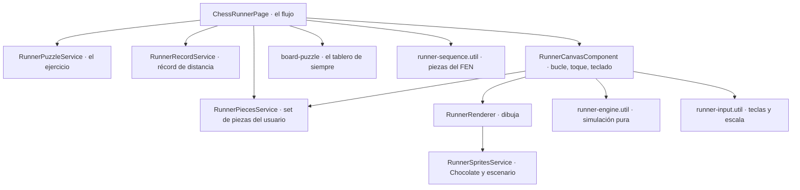

# Flujo del Chess Runner

Un calentamiento antes de cada ejercicio, convertido en un juego de **partidas**: **Chocolate, la mascota, corre** y las
**piezas del ejercicio son los obstáculos**. El control es **tocar para saltar, como en el dinosaurio de Chrome**; dos
toques seguidos, **doble salto**. Se recogen **galletas de ChessColate**, hay **corazones** que se pierden al chocar y un
**récord de distancia**. Al superar las piezas aparece el tablero con su reloj y se resuelve el ejercicio de siempre; al
resolverlo, confeti y **la siguiente carrera arranca sola**, un poco más difícil. La partida acaba con **3 choques o 3
ejercicios fallidos**.

> Este documento describe cómo funciona lo implementado. La idea original (planificación) está en
> [`../features/CHESS_RUNNER.md`](../features/CHESS_RUNNER.md). Allí cada pieza pedía una mecánica distinta (agacharse,
> salto largo…), que se descartó por difícil de recordar: ahora el control sigue siendo uno, y la variedad está en
> **cómo se mueve cada pieza** y en lo que hay en juego.

---

## Qué hace el usuario

Pantalla `/chess-runner` (menú → Práctica → Chess Runner). Una **partida** es una cadena: **buscar un ejercicio →
carrera → ejercicio con reloj → resultado → otra carrera**, hasta que se pierde.

| Con | Qué hace |
|---|---|
| El dedo | **Tocar en cualquier parte de la zona de juego** (no solo el lienzo: el pulgar está abajo). Salta en cuanto se toca. **Dos toques seguidos: doble salto** |
| El teclado | Espacio, ↑ o W (dos veces, doble salto) |

- **El doble salto** es un segundo toque en el aire. Si se da subiendo, el segundo impulso **espera a la cima**, así que
  dos toques rápidos siempre salen bien. Solo hay uno por salto (no hay triple). Si faltan unos 0,12 s para aterrizar,
  un toque de más se guarda y se salta al tocar el suelo. Lo piden las **falanges** y las galletas más altas.
- **Las piezas son más pequeñas que Chocolate** (cuadro de 30 px lógicos frente a sus 40) y **se mueven cada una a su
  manera**, siempre llegando a la hora prevista (ver «Cómo se mueve cada pieza»).
- **Las piezas son las del set que el usuario eligió en Ajustes**, las mismas del tablero (cualquiera de los
  diez), también en las miniaturas de arriba. Así se reconocen al primer vistazo.
- **Corazones y fallos**: se empieza con **3 corazones** y cada choque cuesta uno (Chocolate se queda aturdido, 0,9 s sin
  poder chocar; la pieza **no vuelve**). Sin corazones, se acaba la partida en el acto. **Resolver un ejercicio cura un
  corazón**, y cada **30 galletas** otro. Aparte, hay que no **fallar 3 ejercicios** (también cuenta quedarse sin
  tiempo): con el tercero solo se puede ver la solución y terminar.
- **Récord por distancia**: se corren **metros** (8 px de carrera = 1 m) y se acumulan a lo largo de toda la partida,
  carrera tras carrera. El mejor resultado se guarda en el dispositivo y se ve arriba, junto a los metros de la partida.
  Al acabar, la pantalla de fin dice la distancia, si es **nuevo récord**, el nivel, los ejercicios resueltos y las
  galletas, con «Jugar otra vez» (partida nueva desde el nivel 1) y «Volver al inicio». Salir a mitad de partida
  también guarda lo corrido.
- **Hay progreso y dificultad progresiva**, a varias escalas (ver «Dificultad»): cada **ejercicio resuelto sube un
  nivel** («Nivel N» arriba, un cartel al empezar la carrera y «Subes al nivel N» al resolver), dentro de la carrera **el
  suelo acelera** con cada pieza superada, **las piezas salen de la más baja a la más alta**, desde el nivel 2 aparecen
  **falanges** y **el escenario cambia cada tres niveles** (día, atardecer, noche, amanecer). Arriba a la derecha, la
  **racha** (piezas seguidas sin chocar) se enciende a partir de tres.
- **Sin tutorial**: debajo del lienzo, una línea («Toca para saltar. Dos toques seguidos, doble salto.») y la primera
  pieza sale tras ~1,4 s. **La primera vez que sale una falange** el cartel de la carrera explica el doble salto.
- **«Saltar carrera»** va directo al ejercicio, siempre disponible (lo corrido hasta entonces cuenta para la distancia).
- **Un choque se nota**: la escena tiembla un instante, suena el error y, donde el navegador lo permite (Android), el
  móvil vibra un poco.
- **El ejercicio** sale con **60 s** de reloj. La carrera **no descuenta** tiempo del ejercicio (decisión de diseño:
  es un calentamiento, no una penalización).
- **Resolverlo**: suena, confeti dorado (el tablero se queda como está, **no se rehace**) y, a los 1,6 s, **empieza sola la
  siguiente carrera** con el ejercicio que ya se había descargado. **Sin botón de por medio.**
- **Fallarlo o quedarse sin tiempo**: **no avanza solo**. Se queda el tablero con «Ver solución» y «Otro ejercicio»
  (o «Ver resultado» si era el tercer fallo). **Al cerrar la solución el juego sigue** con otra carrera (o termina la
  partida, en el tercer fallo).
- **No toca el ELO** del usuario y **no crea un `Plan`** (como la Racha). Cada ejercicio cuenta para el recordatorio
  de entrenamiento.

## Las piezas de la carrera

Salen del FEN del ejercicio (`utils/runner-sequence.util.ts`):

1. De cada tipo salen **hasta 2** (alternando bandos si hay de los dos).
2. Máximo **8 obstáculos**. Si hay más se quita el segundo ejemplar de los tipos **más grandes primero** (dos damas
   o dos reyes seguidos son un castigo, no un reto), sin dejar nunca un tipo sin representar.
3. Salen **de la más baja a la más alta** (peón, torre, alfil, caballo, dama, rey): la dificultad sube dentro de la
   carrera. Entre piezas del mismo tipo el orden se mezcla con una **semilla del ejercicio** (determinista: el mismo
   ejercicio da la misma carrera), y cada pieza recibe su **ritmo** (`beat`).
4. **Falanges** (`wallsForLevel`): ninguna en el nivel 1; una en los niveles 2 a 4, dos en 5 a 7 y tres desde el 8. Una
   falange son **tres piezas iguales en fila** y solo se pasa con el doble salto. Nunca es la primera pieza ni una que se
   deslice (`WALL_KINDS`: peón, alfil, caballo y rey).
5. Un tablero sin piezas no tiene carrera: va directo al ejercicio.

`pieceKey(kind, color)` da el nombre de la pieza en el sprite del set (`wp`, `bn`…), el mismo que usa el tablero.

## El motor (`utils/runner-engine.util.ts`)

Una **simulación pura**: `stepRun(estado, dt)` avanza un instante y devuelve el estado nuevo y lo que ocurrió;
`jump(estado)` ejecuta un toque. No sabe de canvas ni de reloj, así que se prueba con carreras guionizadas. Corre a
un **paso fijo de 1/120 s**, y los números del juego se afinaron con él.

- Coordenadas en **píxeles lógicos**; `y` es la altura sobre el suelo. Es el suelo el que pasa (de 120 px/s en el nivel 1 hasta ~230 px/s en el 10);
  Chocolate corre en el sitio.
- **Salto**: sube unos 47 px y dura ~0,64 s. **Doble salto**: un segundo impulso en el aire que lleva a ~81 px y alarga
  el vuelo hasta ~1 s.
- **Cajas indulgentes**: lo que puede chocar es menor que el dibujo, de Chocolate y de las piezas. Casi todas las
  piezas están pegadas al suelo.
- Entre un obstáculo y el siguiente hay un **hueco medido en tiempo** (`gapTimeAfter`), no en píxeles: así el ritmo se
  mantiene aunque el suelo acelere. Cada pieza trae su `beat` (de 0 a 1, sembrado con el ejercicio) y el hueco va del
  mínimo al máximo del nivel: el ritmo no es un metrónomo, y el mínimo de cualquier nivel deja tiempo de aterrizar y
  volver a saltar (lo comprueban las pruebas). Tras una falange el hueco es mayor (el doble salto aterriza más lejos).
- Cada obstáculo lleva un **`plan`** (donde estaría si fuera quieta: va con el suelo y marca cuándo llega) y un **`x`**
  (lo que se ve y choca). Todo lo que se mueve distinto usa `placeObstacle`, que parte del `plan`: por eso **la hora de
  saltar es la misma para todas las piezas** aunque se vean distintas.

### Cómo se mueve cada pieza

Lo que cambia es **lo que se ve venir**, no cuándo hay que saltar (`PIECE_BEHAVIOR`):

| Pieza | Qué hace | Qué pide |
|---|---|---|
| Peón | Quieto | El salto básico |
| Torre | **Se desliza** 1,5 veces más rápido que el suelo y aparece de golpe, con una estela | Reaccionar, que llega rápida |
| Alfil | **Flota** unos 8 px sobre el suelo | El salto **alto** (hay que estar en lo alto del salto al pasar) |
| Caballo | **Salto en L**: poco antes de llegar avanza de golpe 28 px y se eleva | No adelantarse: saltar tras su salto |
| Dama | Combina: se desliza (1,3×) **y** salta en L | Las dos cosas |
| Rey | Quieto, el más alto | El salto más preciso (el margen más corto) |

### Falanges y doble salto

Una falange son tres piezas separadas lo justo (`wallSpacing`, según la velocidad) para que **un salto sencillo no pueda
pasar por encima de todas** y uno doble sí. Las pruebas barren el instante de los toques en los niveles 1, 5 y 10: con un
salto sencillo **ninguno** acierta, con el doble queda un margen de ~0,2 a 0,3 s.

### Galletas de ChessColate

Cada pieza trae **tres en arco encima** (a unos 40 px: se cogen con un salto bien hecho, no corriendo) y, si su ritmo es
corto, **una fila de tres a ras de suelo** a mitad del hueco (se cogen corriendo, sin saltar). Sobre una falange van
**arriba del todo** (85 px): solo llegan con el doble salto. Cada **30** devuelven un corazón (`COOKIES_PER_HEART`). La
galleta es pixel art dibujado en el lienzo (no hay sprite).

### Dificultad (`difficultyForLevel`)

`nivel = ejercicios resueltos en la partida + 1`; la velocidad y el ritmo suben hasta el 10 (`MAX_LEVEL`); fallar un
ejercicio **no baja** el nivel, y una partida nueva (o salir de la pantalla) vuelve al 1.

| Nivel | Suelo al empezar → al acabar | Hueco entre piezas (mín–máx) |
|---|---|---|
| 1 | 120 → 142 px/s | 1,10 – 1,40 s |
| 5 | 144 → 178 px/s | 0,98 – 1,29 s |
| 10 | 174 → 223 px/s | 0,83 – 1,15 s |

Palancas, para que se note el avance sin cambiar el control: **velocidad** (por nivel y dentro de la carrera, con una
subida suave, sin tirones), **ritmo** (menos hueco y más irregular), **orden** (de peón a rey), **falanges** (más con el
nivel) y **escenario** (`worldOfLevel`: día, atardecer, noche y amanecer, uno cada tres niveles; el cartel de la
carrera lo anuncia). Las pruebas de `runner-engine.util.spec.ts` comprueban que un jugador que salta con la misma
antelación (y da dos toques en las falanges) pasa las piezas más duras con el ritmo más apretado de los niveles 1, 4,
7 y 10, y que con falanges sigue siendo posible en el 2, el 5 y el 10.

### Equilibrio

Las medidas de cada pieza (`config/runner.config.ts`, `OBSTACLE_SHAPES`) están fijadas por pruebas que **barren el
instante del toque y miden la ventana de acierto** (`tests/unit/features/chess-runner/utils/runner-engine.util.spec.ts`):

| Pieza | Choca (ancho × alto) | Margen para acertar |
|---|---|---|
| Peón | 8 × 11 | ~0,34 s |
| Torre | 10 × 15 | ~0,37 s (se desliza, pasa más rápido) |
| Alfil | 10 × 15, flotando 8 | ~0,21 s |
| Caballo | 12 × 18 | ~0,24 s |
| Dama | 10 × 21 | ~0,29 s |
| Rey | 10 × 23 | ~0,21 s |

Márgenes medidos con el suelo del nivel 1; en el nivel 10 son mayores (más de 0,28 s). Toda pieza se supera con un salto
y deja al menos 0,2 s, sin hacer nada **siempre** se choca, y saltar mucho antes o mucho después no sirve. Si cambias una
medida y una de estas pruebas falla, el juego se ha vuelto injusto o trivial.

## La entrada (`utils/runner-input.util.ts` y el lienzo)

`pointerdown` en la zona de juego salta **al instante** (no se espera a soltar ni a distinguir gestos); un segundo
`pointerdown` en el aire es el doble salto. Un botón de la pantalla (salir, saltar carrera) sigue siendo un botón. El
teclado: `isJumpKey` (Espacio, ↑, W), sin repetición automática.

## Dibujo y escala

`components/runner-canvas/` pinta con un lienzo 2D. Todo en píxeles lógicos y a una **escala entera** (el pixel art no
admite fracciones): `round(ancho / 220)`, así el ancho lógico queda entre 165 y 275 px y el alto es siempre 176.
En pantallas de alta densidad el lienzo se dibuja a resolución nativa sin cambiar el tamaño en pantalla. El
bucle corre **fuera de la zona de Angular** y solo entra en ella cuando hay algo que contar; con un paso fijo y un
tope por fotograma, una pestaña dormida no se «pone al día» de golpe.

`runner-renderer.ts` no sabe de Angular: recibe el estado y dibuja cielo, nubes, horizonte y colinas con paralaje, el
suelo de tablero, las sombras, los obstáculos, a Chocolate (animación según lo que hace) y los efectos. Chocolate y el
escenario son pixel art (sin suavizado); **las piezas son vectoriales** (cuadro de 30 px lógicos) y se dibujan
suavizadas. También pinta las galletas, la estela de la torre, las estrellas de la noche y un tinte por mundo sobre el
cielo y las colinas.

### Las piezas del usuario (`services/runner-pieces.service.ts`)

El set viene en un solo SVG (el sprite de `cm-chessboard`, un `<g id="wk">` por pieza, ruta de
`PIECES_FILES[getChessboardAppearance().pieces]`). El servicio lo parte en **doce SVG sueltos de 40×40**, conservando
los `<g>` que envuelven a la pieza (algunos sets ponen ahí el trazo o el relleno), y devuelve cada una como imagen para
el lienzo y como URL `data:` para las miniaturas. Cada set se descarga **una vez**; si el usuario cambia de set en
Ajustes, la siguiente carrera usa el nuevo. Si no baja, el lienzo avisa y se salta la carrera.

## Los assets

Pixel art generado por código, determinista y verificable, en el pipeline que ya existía para el directo 24/7:
[`tools/stream-assets/`](../../tools/stream-assets/README.md) (`runner.py`, `export_runner.py`). Salen a
[`assets/images/runner/`](../../apps/chessColate/src/assets/images/runner/) con un `runner.json` que describe cada tira.

- **Chocolate** (el mismo cuerpo y paleta que en el directo): correr (4 cuadros), saltar (subir, cima, bajar),
  tropezar y contento.
- **Escenario con capas de paralaje**: cielo, nubes, un **horizonte de piezas de ajedrez gigantes** (que ata el
  escenario con la temática), colinas y el suelo, que es un tablero.
- **Efectos**: polvo al despegar y aterrizar, chispa al dejar una pieza atrás.

No hay sprites de piezas ni de pistas: las piezas son las del set del usuario y las pistas se quitaron con los
controles por pieza. (Las siluetas de pixel art de `runner.py` solo dibujan el horizonte.)
`export_runner.py --check` comprueba píxel a píxel que lo versionado coincide con lo que generan los scripts.

## ¿Cómo está montado?

Todo en [`features/chess-runner/`](../../apps/chessColate/src/app/features/chess-runner/). El ejercicio sale del catálogo
(`RunnerPuzzleService`: un tema táctico al azar, cerca del ELO del usuario, sin repetir en la sesión) y el
**siguiente se precarga** mientras se resuelve el actual; así la carrera que arranca sola tras un acierto es inmediata, y
si la precarga falló se reintenta antes de dar error. **Lo único que guarda en el dispositivo es el récord de distancia**
(`RunnerRecordService`, `localStorage` en `chessColate_runner_best_m`; sin acceso al almacenamiento el juego sigue sin récord).

## Analítica

`chess_runner_started` (`obstacles`, `level`), `chess_runner_finished` (`obstacles`, `stumbles`, `clean`, `duration_ms`,
`meters`, `cookies`, `hearts`, `best_combo`, `level`, `skipped`) y `chess_runner_game_over` (`reason`: `hits` o `strikes`,
`meters`, `level`, `solved`, `cookies`, `new_record`). El ejercicio emite `puzzle_started` y `puzzle_completed` con
`routine_kind: 'runner'`.

## Decisiones tomadas

1. **Motor propio en canvas 2D, no Phaser.** El runner necesita un salto y una colisión: una simulación pura, probada
   sin dibujar nada, evita ~1 MB de dependencia y un motor que no se puede probar con Jest.
2. **Un solo control.** La primera versión pedía seis mecánicas (tocar, agacharse, salto largo, mantener, doble salto,
   salto preciso) y resultaba difícil de recordar. Ahora todo es saltar y solo se añade el doble salto (dos toques
   seguidos, que se ejecuta en la cima para que no pueda salir mal); la variedad está en cómo se mueve cada pieza, no
   en qué hay que pulsar.
3. **La carrera no descuenta tiempo** del ejercicio: 60 s fijos.
4. **Resolver encadena la siguiente carrera sin botón**; fallar sí espera, para poder ver la solución.
5. **Modo propio, no un interruptor en las rutinas**: se juega desde el menú y no cambia las rutinas existentes.
6. **Piezas del set del usuario** (coherencia con el tablero y reconocibles de un vistazo), no pixel art propio.
7. **Sonido**: se reutilizan los sonidos de la app (no hay audio nuevo).
8. **Se puede perder.** Con solo subir la velocidad el juego se sentía plano: no había nada en juego. Ahora hay 3
   corazones y 3 fallos, y el récord es de distancia acumulada en toda la partida (como el dinosaurio de Chrome). Los
   corazones se recuperan (resolver, galletas) porque 3 choques seguidos en toda una partida larga serían demasiado.
9. **Las piezas llegan a su hora.** Cada una se mueve a su manera, pero todas parten de un `plan` común, así que la
   ventana para saltar no cambia y se puede probar con un barrido de toques.
10. **Sin reintento de pieza.** Antes la pieza con la que se chocaba reaparecía; con corazones, un choque es un choque.

## Límites conocidos

- Solo está en el menú: no hay tarjeta en el inicio ni se puede activar delante de las rutinas.
- Solo se guarda el récord de distancia (en el dispositivo, sin sincronizar con el perfil): el nivel y la racha son de la partida.
- Pasado el nivel 10 la velocidad y el ritmo ya no suben (sí siguen las falanges y el escenario).
- Los sonidos son los generales de la app; no hay uno propio por pieza.
- El runner no respeta (todavía) un ajuste de «menos movimiento» del sistema.
- En un tema oscuro, las piezas negras de algunos sets se leen peor en las miniaturas: llevan un fondo suave del tema.

## Pruebas

- Unitarias en [`tests/unit/features/chess-runner/`](../../apps/chessColate/tests/unit/features/chess-runner/): el motor (física,
  ventanas de acierto por pieza y de las falanges, el doble salto, el movimiento de cada pieza, las galletas, la
  dificultad por nivel), la secuencia desde el FEN y sus falanges, la entrada, el lienzo y el pintor con un
  canvas simulado, el servicio de piezas, el del récord, los demás servicios, la pantalla (corazones, fallos, fin de
  partida, récord, galletas, el cartel de cada carrera, que el tablero no se recree al resolver y el avance
  automático tras un acierto) y un cruce de assets y traducciones.
- Python: [`test_runner_assets.py`](../../tools/stream-assets/test_runner_assets.py) (`./.venv/bin/python -m unittest`).
- E2E en [`specs/chess-runner.spec.ts`](../../apps/chessColate-e2e/specs/chess-runner.spec.ts): una captura de la pantalla
  (con el lienzo tapado, porque se anima), las miniaturas con el set elegido, una carrera completa jugada con el teclado
  sin tropezar, otra sin tocar nada (que acaba en fin de partida con récord), «Jugar otra vez», el doble salto, toques
  reales (CDP), resolver (y que arranque sola la siguiente, de nivel 2), fallar, cerrar la solución y el agotamiento del
  catálogo.
