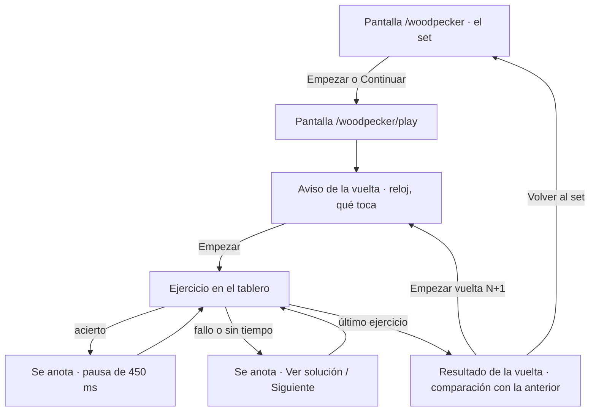
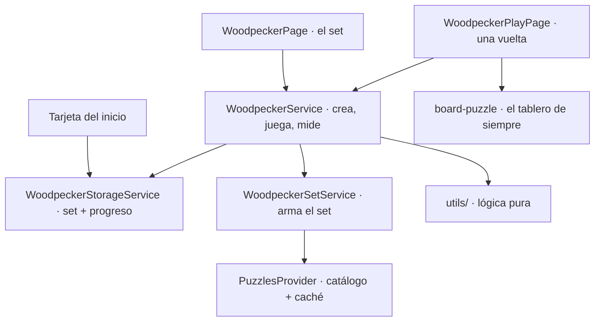

# Flujo del Método del Pájaro Carpintero

Entrenamiento por **repetición**: el usuario arma un set fijo de ejercicios con
el catálogo de la app y lo resuelve en varias vueltas, **siempre los mismos
ejercicios**, con menos tiempo en cada una. Lo que se mide no es la novedad sino
cuánto mejora la precisión y la velocidad sobre el mismo material.

> Este documento describe cómo funciona lo implementado. La idea original
> (planificación) está en [`../features/METODO_PAJARO_CARPINTERO.md`](../features/METODO_PAJARO_CARPINTERO.md).

---

## Reglas del modo

| Regla | Comportamiento |
|---|---|
| **El set** | Se arma una vez con lo que elige el usuario y se **congela**: todas las vueltas usan exactamente esos ejercicios. |
| **Un solo set** | Solo existe uno a la vez. Armar otro sustituye al anterior (la pantalla avisa). |
| **Qué elige el usuario** | Tamaño (50 / 100 / 200 / 300 / 500), rango de ELO (de 100 en 100, mínimo 200 de ancho), temas (mezcla variada o los que marque), número de vueltas (2 a 12), orden entre vueltas y ritmo. |
| **Vuelta 1** | Siempre en el orden del set: es la base con la que se compara. |
| **Orden después** | *Mezclado* (por defecto, para no memorizar la secuencia), *el mismo*, o *alterno* (las vueltas pares van al revés). |
| **Ritmo** | *Sin reloj*, *Estándar* (60 s en la vuelta 1) o *Intenso* (30 s). Con reloj, cada vuelta baja un 20 % respecto a la anterior, sin pasar de 10 s. |
| **Fallar** | No termina nada: se anota, se puede ver la solución y se sigue. Quedarse sin tiempo cuenta como fallo. |
| **Reanudable** | El progreso se guarda tras **cada ejercicio**. Se puede salir y volver por donde se quedó, incluso tras cerrar la app. |
| **ELO del usuario** | **No se toca**. Es una métrica propia del set. |
| **Dónde vive** | Solo en el dispositivo (`localStorage`). No requiere sesión ni red una vez armado el set. |

## Cómo se arma el set

El catálogo guarda los ejercicios en archivos por **tema y franja de 20 puntos de
ELO** (250 a 700 KB, con cientos de ejercicios cada uno). Pedir una franja por
cada 20 puntos del rango sería bajar decenas de archivos, así que el set se arma
con **pocos archivos repartidos por todo el rango**:

1. El tamaño pedido se reparte a partes iguales entre los temas (los que no
   tienen archivos en el rango se descartan).
2. Dentro de cada tema se eligen unos pocos archivos (≈ 25 ejercicios por archivo),
   uno por tramo del rango, al azar dentro de cada tramo: el set cubre el rango
   entero y dos sets con los mismos filtros no usan siempre los mismos archivos.
3. De cada archivo se piden el doble de ejercicios de los que se quieren, para
   poder descartar los que entran por dos temas a la vez.
4. Si aun así faltan, hasta tres pasadas extra con archivos nuevos, calculando
   cuántos hacen falta según lo que rindieron los primeros.
5. El resultado sale **mezclado**: es el orden de la vuelta 1 y alterna temas y
   dificultades en vez de ir por bloques.

Un set se **acepta con al menos el 70 %** del tamaño pedido. Con menos, no se
guarda nada y la pantalla explica cuántos ejercicios se encontraron y qué ampliar
(rango de ELO o más temas). Con entre el 70 % y el 100 % se acepta y se avisa de
cuántos salieron. «Todos los temas» sortea **10** del catálogo, para no bajar
decenas de archivos.

Ejemplo real (catálogo de producción): 50 ejercicios de 3 temas en el rango
1300–1700 → **3 archivos descargados**, 19 KB guardados. El peor caso, 500
ejercicios de un solo tema, ocupa unos 200 KB.

## Cómo se juega una vuelta

- El **tiempo por ejercicio lo fija la vuelta**, no el ejercicio: se le pone al
  puzzle justo antes de mostrarlo, así el mismo ejercicio tiene menos tiempo cada
  pasada. El tablero lo trata como en cualquier rutina (barra, aviso a la mitad,
  peligro a la cuarta parte).
- **Lo que tarda cada ejercicio** lo mide la pantalla (del momento en que sale al
  tablero hasta el resultado) porque el reloj del tablero solo corre con límite de
  tiempo. Se anota con un tope de **5 minutos** por ejercicio: dejar la app abierta
  sin tocar no es «lo que tardó».
- Tras un acierto hay una **pausa de 450 ms** (la jugada buena se ve) que no cuenta
  como tiempo del ejercicio siguiente, y las jugadas durante esa pausa se ignoran.
- Cada vuelta cuenta como **una sesión de entrenamiento** para los recordatorios
  (`onSessionStarted` al empezar, `onSessionCompleted` al terminar).

## La medición

Al terminar cada vuelta, y en el panel del set, se enseña:

- **Acierto** (% de ejercicios resueltos) y **tiempo total** (con el tiempo medio por ejercicio).
- **Qué cambió respecto a la vuelta anterior**: puntos de acierto ganados o perdidos
  y porcentaje de tiempo más rápido o más lento. Un cambio que se redondea a 0 no se enseña.
- La **evolución** de todas las vueltas terminadas, una fila por vuelta.
- Los ejercicios que **se fallan en dos o más vueltas** («los que más se resisten»),
  cada uno con su botón para ver la solución, rotulados por su motivo táctico
  (sin «Ventaja» ni «Ejercicio corto»).

## ¿Cómo está montado?

Todo vive en [`features/woodpecker/`](../../apps/chessColate/src/app/features/woodpecker/):

| Pieza | Qué hace |
|---|---|
| `utils/woodpecker-config.util.ts` | Arma y valida la configuración: rango de ELO, temas, mínimo aceptable, estimación de duración. |
| `utils/woodpecker-set.util.ts` | Qué archivos del catálogo bajar y qué ejercicios se quedan. |
| `utils/woodpecker-cycle.util.ts` | Orden de cada vuelta, tiempo por ejercicio y las transiciones del progreso (empezar, anotar, cerrar). Todo inmutable. |
| `utils/woodpecker-stats.util.ts` | Resumen de una vuelta, comparación entre vueltas y ejercicios problemáticos. |
| `utils/woodpecker-validation.util.ts` | Comprueba la forma de lo que se lee del dispositivo; lo corrupto se descarta. |
| `utils/woodpecker-home.util.ts` | Lo mínimo que necesita la tarjeta del inicio. |
| `services/woodpecker-set.service.ts` | Descarga y ensambla el set. Único sitio que habla con el catálogo. |
| `services/woodpecker-storage.service.ts` | `localStorage`: el set y el progreso. |
| `services/woodpecker.service.ts` | Orquesta y registra la analítica. |
| `pages/woodpecker/` | El set: configurar, panel, evolución, abandonar. |
| `pages/woodpecker-play/` | Juega una vuelta. |
| `containers/woodpecker-setup/` | El formulario de configuración. |
| `components/` | Panel, gráfica de evolución y resultado de vuelta (solo pintan). |

**No crea un `Plan`** ni pasa por los bloques de las rutinas (igual que la Racha):
el set congelado y el progreso son sus propios datos, en `features/woodpecker/models/`.

## Dónde se guarda

| Dato | Clave de `localStorage` | Cuándo se escribe |
|---|---|---|
| El set congelado (ejercicios completos + filtros usados) | `chessColate_woodpecker_set` | Una vez, al crearlo |
| El progreso (vueltas, orden de cada una, resultados) | `chessColate_woodpecker_progress` | Tras cada ejercicio |

Van en claves aparte porque el set pesa cientos de KB y no cambia, mientras que el
progreso se escribe a cada ejercicio. Si el dispositivo no deja escribir el set
nuevo, **no queda nada a medias**: se restaura lo anterior y se avisa. Un progreso
que no es del set guardado se ignora. La **caché de ejercicios** del catálogo
(IndexedDB) es independiente: borrarla desde Ajustes → Almacenamiento no afecta a
un set ya armado, que se guardó entero.

## Analítica

Eventos nuevos (catálogo completo en [OBSERVABILITY_REFERENCIA](./OBSERVABILITY_REFERENCIA.md)):
`woodpecker_plan_created`, `woodpecker_set_short`, `woodpecker_cycle_started`,
`woodpecker_cycle_completed`, `woodpecker_plan_completed`, `woodpecker_plan_abandoned`.
Los ejercicios emiten `puzzle_started` y `puzzle_completed` con `routine_kind: 'woodpecker'`.

## Decisiones tomadas

Las seis decisiones abiertas del diseño original, resueltas:

1. **Tamaños**: 50 a 500, por defecto 100; mínimo aceptable el 70 % del pedido.
2. **Tiempo**: decreciente por porcentaje (−20 % por vuelta, mínimo 10 s) en lugar de «la mitad en la segunda mitad de las vueltas»: reducir a la mitad cada vuelta (el libro lo hace con el tiempo total de la vuelta) dejaría ejercicios de menos de un segundo con 7 vueltas.
3. **Orden**: mezclado por defecto (evita memorizar la secuencia); la vuelta 1 siempre va en el orden del set.
4. **ELO**: métrica propia del set, no toca el ELO del perfil.
5. **Persistencia**: los ejercicios completos, no solo los uids, para jugar sin red y sin depender de la caché.
6. **Fuente**: el catálogo o, desde F07, un PGN propio (ver [RUTINA_PGN_FLOW](./RUTINA_PGN_FLOW.md)).  El set guarda su `source` (`'catalog'` o `'pgn'`).

## Límites conocidos

- **Solo local**: no sobrevive a reinstalar la app ni pasa de un dispositivo a otro (como el historial de rutinas).
- **Un solo set a la vez.**
- **Sin recordatorios propios de las vueltas**: cada vuelta cuenta como sesión de entrenamiento para el recordatorio general, pero no hay una agenda del set.
- El repaso de los ejercicios problemáticos es **ver su solución**; no hay un modo de práctica dirigido a ellos.

## Pruebas

- Unitarias en [`tests/unit/features/woodpecker/`](../../apps/chessColate/tests/unit/features/woodpecker/): lógica pura, servicios, componentes y las dos pantallas (la de juego con el servicio y el almacenamiento reales). Incluyen un cruce de traducciones: toda clave usada existe en español e inglés y no sobra ninguna.
- E2E en [`specs/pajaro-carpintero.spec.ts`](../../apps/chessColate-e2e/specs/pajaro-carpintero.spec.ts): con un set sembrado de los tres ejercicios de los fixtures, juega las dos vueltas, falla, ve la solución, sale y retoma tras recargar, abandona y comprueba la tarjeta del inicio. Armar el set contra el catálogo real se verifica con `/chesscolate:probar`.
