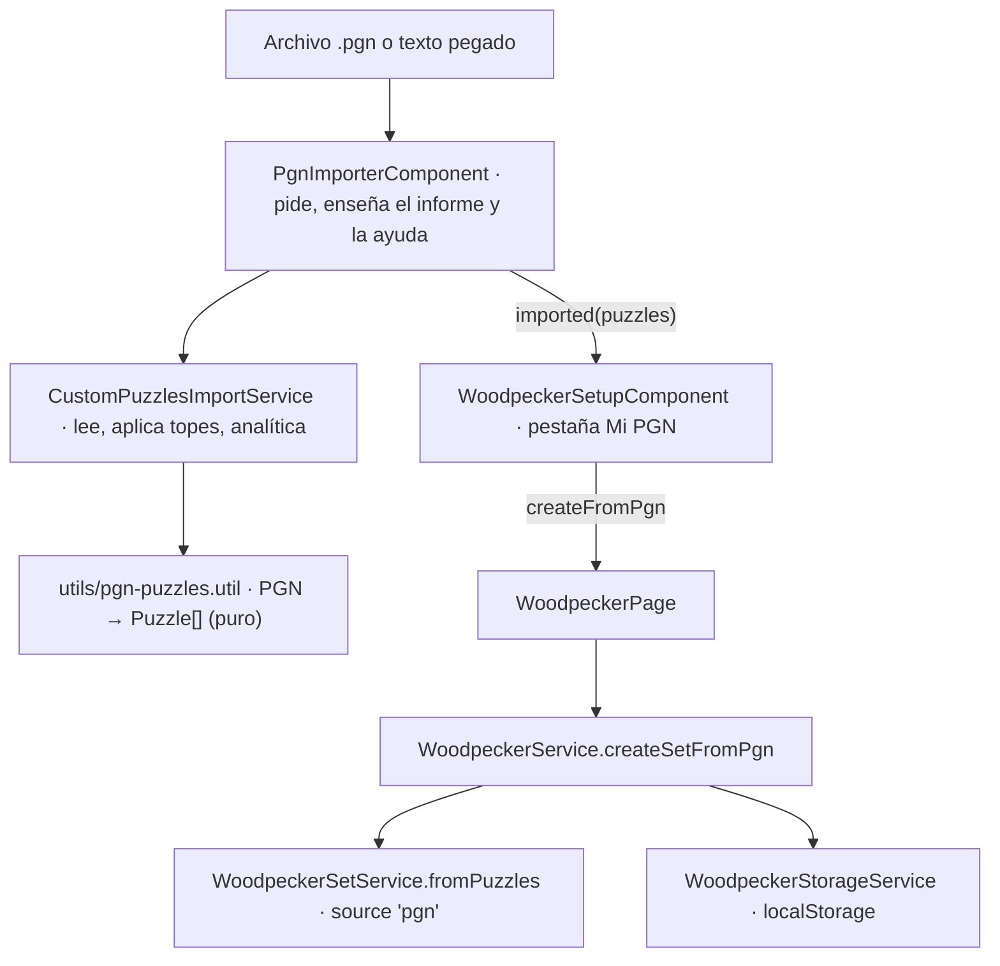

# Flujo de ejercicios propios con PGN (F07)

El usuario trae **su propio archivo PGN** de ejercicios y lo entrena con el Método del Pájaro Carpintero,
en lugar de usar el catálogo de la app. Es la primera entrega de F07: el set del Pájaro Carpintero acepta
una segunda fuente (`source: 'pgn'`). Las rutinas personalizadas por bloques **no** lo usan todavía (ver
[Fuera de esta entrega](#fuera-de-esta-entrega)).

> Este documento describe cómo funciona lo implementado. El diseño original está en
> [`../features/RUTINA_PGN_PERSONALIZADA.md`](../features/RUTINA_PGN_PERSONALIZADA.md).

---

## Cómo se usa

1. **Pájaro carpintero → «Mi PGN»** (pestaña junto a «Catálogo» en la configuración del set).
2. **Elegir archivo `.pgn`** o desplegar «O pega el texto».
3. La app lee el archivo **al momento** y enseña un informe: `6 de 8 ejercicios listos`, los que no entraron
   (con su título y el motivo) y los avisos de lo que se corrigió solo.
4. Se eligen vueltas, orden y ritmo igual que con el catálogo y se pulsa **Armar mi set**.
5. El panel dice `De tu archivo PGN · nombre.pgn`. Las vueltas se juegan igual que siempre.

| Regla | Comportamiento |
|---|---|
| **Qué entra** | Todos los ejercicios válidos del archivo, **en el orden del archivo** (la vuelta 1 lo respeta; el orden de las siguientes lo marca la opción «Orden en cada vuelta»). |
| **Máximo** | 500 ejercicios. Si el archivo trae más, se usan los primeros 500 y se avisa. |
| **Mínimo** | 5 ejercicios válidos. Con menos se enseña el informe pero no se deja armar el set. |
| **Tamaño del archivo** | Hasta ≈ 2 MB de texto. Lo que no es texto (una imagen, un zip) se rechaza. |
| **Tolerancia** | Un ejercicio malo se anota en el informe; el resto entra igual. |
| **ELO del usuario** | **No se toca**: es una métrica propia del set, igual que con el catálogo. |
| **Dónde vive** | `localStorage`, como el resto del Pájaro Carpintero. No hay sincronización con la cuenta. |

---

## Estructura del PGN de ejercicios

> **En una frase:** cada ejercicio es una partida del archivo cuyo `[FEN]` es la posición **antes de la jugada
> del rival**; la línea empieza con esa jugada del rival (que se juega sola) y sigue con **tu solución**.

### Plantilla

```pgn
[Event "Mate del pasillo"]
[FEN "6k1/p4ppp/8/8/8/8/5PPP/4R1K1 b - - 0 1"]
[PuzzleRating "900"]
[PuzzleThemes "mateIn1 backRankMate"]

1... a6 2. Re8# *

[Event "Horquilla de caballo"]
[FEN "r3k3/7p/8/3N4/8/8/8/4K3 b q - 0 1"]
[PuzzleRating "1200"]
[PuzzleThemes "fork"]

1... h6 2. Nc7+ Kd7 3. Nxa8 *
```

Este mismo ejemplo se enseña en la ayuda de la pantalla («¿Cómo debe ser el PGN?») con botones para
**copiarlo** y **descargarlo** (`ejercicios-ejemplo.pgn`). Vive en
`features/custom-puzzles/config/custom-pgn-template.ts` y una prueba comprueba que se lee sin problemas.

### Las reglas

1. **Un ejercicio = un bloque de etiquetas `[…]` seguido de sus jugadas.** Deja una línea en blanco entre
   ejercicios. No hace falta `[Event]`: un ejercicio nuevo empieza con la primera etiqueta que aparece después
   de haber visto jugadas.
2. **`[FEN]` es la posición ANTES de la jugada del rival.** Si sacas el ejercicio de una partida, es la
   posición justo antes del error del rival. Sin `[FEN]` se toma la posición inicial (sirve para líneas de
   apertura) y se avisa.
3. **La línea alterna: rival, tú, rival, tú…** La primera jugada es del rival y se ejecuta sola al
   mostrar el ejercicio. Todo lo demás es la solución. Las respuestas del rival en medio también se juegan solas.
4. **Tiene que acabar en una jugada tuya.** Si la línea acaba en una del rival, se quita esa última jugada y se
   avisa. Hacen falta como mínimo dos jugadas (rival + tú).
5. **Solo cuenta la línea principal.** Variantes `( … )`, comentarios `{ … }` y símbolos (`!`, `?`, `$1`) se
   ignoran. Jugadas en notación estándar: `Nf3`, `exd5`, `O-O`, `e8=Q+`.
6. **Un mate vale aunque no sea el de la solución**: si tu jugada da mate se da por buena (es la regla de
   todos los ejercicios de la app).

### Etiquetas

| Etiqueta | Obligatoria | Qué hace |
|---|---|---|
| `[FEN "…"]` | Sí en la práctica | Posición antes de la jugada del rival. |
| `[Event "…"]` | No | Nombre del ejercicio; sale en el informe si algo falla. |
| `[PuzzleRating "1450"]` (o `[Rating]`) | No | Dificultad. Si falta, **1500**. |
| `[PuzzleThemes "fork pin"]` (o `[Themes]`) | No | Temas separados por espacios o comas. Los que usa el catálogo (`fork`, `pin`, `mateIn2`, `backRankMate`…, en camelCase) salen con su nombre traducido; cualquier otro texto sale tal cual. Si falta, el tema es «Propio». |
| `[Site "https://…"]` (o `[Link]`) | No | Si es una URL, se guarda como enlace de la partida. |

El resto de etiquetas (`White`, `Black`, `Date`, `Result`, `SetUp`…) se ignoran.

### Cómo sacar ejercicios de una partida

1. Encuentra el error del rival en una partida (por ejemplo, con el análisis de tu motor).
2. Copia el **FEN de la posición justo antes de ese error**.
3. Escribe la línea: la jugada errónea del rival y, a continuación, tu mejor continuación.

### Si tu posición ya empieza con tu turno

Es lo habitual en un estudio de Lichess o en ChessBase. **Todavía no se admite directamente** (el tablero da por
hecho que la primera jugada es del rival). Se arregla en un paso: usa el FEN **una jugada antes** y pon primero la
última jugada del rival.

### Qué hace la app con lo que lee

| Caso | Resultado |
|---|---|
| `[FEN]` que no es una posición válida | No entra: «El [FEN] no es una posición válida». |
| Jugada ilegal en su posición | No entra y dice cuál: «La jugada «Qh5» no es legal en esa posición». |
| Jugadas mal escritas (`Re9#`) | No entra: «No se pudieron leer sus jugadas». |
| Sin jugadas / una sola jugada | No entra: «No tiene jugadas» / «Necesita al menos dos jugadas». |
| Mismo ejercicio repetido (misma posición y jugadas) | Entra solo la primera. |
| Línea que acaba en jugada del rival | Entra sin esa última jugada, con aviso. |
| Sin `[FEN]` | Entra desde la posición inicial, con aviso. |

---

## ¿Cómo está montado?



Todo lo nuevo vive en [`features/custom-puzzles/`](../../apps/chessColate/src/app/features/custom-puzzles/), pensado para
que cualquier pantalla que quiera ejercicios propios los reciba ya convertidos en `Puzzle`:

| Pieza | Qué hace |
|---|---|
| `utils/pgn-puzzles.util.ts` | `splitExercises` (corta el archivo), `parsePgnExercises` (convierte con `chess.js` y devuelve ejercicios, problemas y avisos), `checkPgnText`, `limitExercises`, `themeLabel`. Funciones puras. |
| `services/custom-puzzles-import.service.ts` | Lee el `File` o el texto, aplica tamaño y tope, registra la analítica. No guarda nada. |
| `containers/pgn-importer/` | Elegir archivo o pegar, informe de importación, ayuda con ejemplo. |
| `config/custom-puzzles.config.ts` | Tope (500), mínimo (5), tamaño máximo, rating y tema por defecto. |
| `config/custom-pgn-template.ts` | El ejemplo de la ayuda. |

Cambios en `woodpecker/`: `WoodpeckerSource` pasa a `'catalog' | 'pgn'` y el set guarda `sourceName` (nombre del
archivo); `buildPgnWoodpeckerConfig` resume rango de ELO y temas del archivo; `WoodpeckerService.createSetFromPgn`
guarda sin descargar nada; el panel muestra el origen. Lo guardado antes de esta entrega ya era `'catalog'`: no se migra.

### Conversión a `Puzzle`

| Campo | Sale de |
|---|---|
| `fen` | `[FEN]` (o la posición inicial). |
| `moves` | La línea principal en UCI (`a7a6 e1e8`); la primera es la del rival. |
| `rating` | `[PuzzleRating]` o 1500. |
| `themes` | `[PuzzleThemes]` o `['custom']`. |
| `uid` | `pgn-` + hash del `fen` y las jugadas: el mismo ejercicio da siempre el mismo uid (así se detectan repetidos). |
| `gameUrl` | `[Site]` si es una URL. |

---

## Analítica

Eventos nuevos (catálogo en [OBSERVABILITY_REFERENCIA](./OBSERVABILITY_REFERENCIA.md)): `custom_pgn_import_started`
(`via`: `file` o `paste`), `custom_pgn_import_completed` (`total`, `imported`, `failed`, `enough`),
`custom_pgn_import_failed` (`reason`). `woodpecker_plan_created` gana el parámetro `source` (`catalog` o `pgn`).

---

## Fuera de esta entrega

- **Rutinas personalizadas por bloques** (`Block.puzzleSource`, `CustomPuzzleSet` referenciado por id): el diseño
  original lo preveía, pero el Pájaro Carpintero ya tiene su set congelado y se reutilizó en lugar de crear uno
  paralelo. Para llevarlo a las rutinas, `features/custom-puzzles/` ya entrega los `Puzzle[]` listos.
- **Posición que empieza con el turno del usuario** (estudios de Lichess tal cual): exige que `board-puzzle`,
  `board-puzzle-solution` y la vista de resultado admitan una solución sin jugada inicial del rival.
- Importar por URL de un estudio de Lichess, editor de ejercicios dentro de la app, sincronizar sets con la cuenta.
