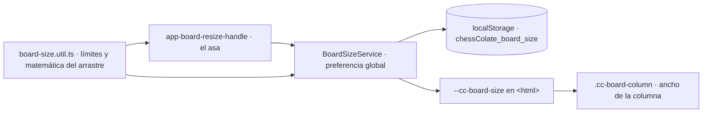

# Tablero redimensionable (escritorio)

En escritorio con ratón el usuario puede **cambiar el tamaño del tablero** arrastrando un
asa en su esquina inferior derecha, como en lichess. La preferencia es **una sola para todos los
tableros**, se guarda en el dispositivo y, mientras nadie la toque, cada pantalla conserva el
tamaño que ya tenía.

## Qué hace el usuario

| Acción | Resultado |
|---|---|
| **Arrastrar** el asa de la esquina inferior derecha | El tablero crece o encoge; el asa sigue al puntero. Al soltar, se guarda. |
| **Flechas** (→ ↑ más, ← ↓ menos) con el asa enfocada | Cambia de 16 en 16 px y se guarda. |
| **Doble clic** en el asa | Vuelve al tamaño de siempre de cada pantalla y borra la preferencia. |

- **Solo en escritorio con ratón**: el asa existe a partir de 1024 px de ancho y con `hover` y puntero
  fino (`@media (min-width: 1024px) and (hover: hover) and (pointer: fine)`). En móvil y con el dedo
  no se ve, y una preferencia guardada **no cambia** el tablero del móvil (que llena el ancho).
- **Límites**: de 320 px a lo que cabe en la ventana. Lo elegido nunca pasa del alto disponible:
  `alto de la ventana − 150 px` en las pantallas de ejercicios y `− 240 px` en las que tienen título
  y ajustes sobre el tablero. Si la ventana se encoge, el tablero se acota solo (sin perder lo guardado).

## Dónde aplica

| Pantalla | Clase de la columna | Tamaño sin preferencia |
|---|---|---|
| Entrenamiento (`puzzles/training`) | `cc-board-column` | `clamp(480px, 100vh − 190px, 640px)` |
| Racha (`streak`) | `cc-board-column` | ídem |
| Pájaro carpintero, vuelta (`woodpecker/play`) | `cc-board-column` | ídem |
| Coordenadas · Recorrido del caballo · Chess960 | `cc-board-column cc-board-column--compact` | 480 px |

Las demás pantallas con tablero (reproductor de partidas, vista previa de apariencia, onboarding,
tablero del inicio) **no lo usan**: tienen su propio layout.

## Cómo está montado

- **`core/app/board-size.util.ts`** — límites (320 a 1200), reservas de alto por tipo de pantalla, lectura
  segura de lo guardado y la matemática del arrastre. Puro y probado.
- **`core/app/board-size.service.ts`** — guarda la preferencia (`chessColate_board_size`) y la publica en la
  variable CSS `--cc-board-size` de `<html>`. Se inicializa al arrancar, antes de pintar el primer tablero.
  Sin preferencia la variable **no existe**.
- **`shared/components/board-resize-handle`** — el asa. Se pone dentro de la columna del tablero (que debe
  ser `relative`): se pinta como un cuadrado del ancho de la columna y el asa va en su esquina.
- **`.cc-board-column` en `global.scss`** — el ancho de la columna:
  `max(320px, min(var(--cc-board-size, <el de siempre>), 100vh − reserva))`.

### Por qué el asa mide en vez de calcular

Las columnas de tablero están **centradas** en la pantalla (tablero + hueco + panel). Al crecer el
tablero su borde izquierdo retrocede, así que la esquina inferior derecha avanza solo **la mitad**
en horizontal (y todo en vertical). Si el tamaño siguiera al puntero con una fórmula fija, el asa se
separaría de él. En cada paso del arrastre se mide cuánto se movió el asa por cada píxel que creció el
tablero y se corrige hasta alcanzar al puntero (mínimos cuadrados sobre los dos ejes, porque con un solo
grado de libertad no se pueden clavar los dos). Así funciona igual en cualquier maquetación.

### Añadir el asa a una pantalla nueva

1. La columna del tablero lleva `cc-board-column` (y `cc-board-column--compact` si tiene título y ajustes
   encima) y es `relative`.
2. Dentro de esa columna, junto al tablero: `<app-board-resize-handle></app-board-resize-handle>`
   (con `[reserve]="240"` si es `--compact`).
3. Importar `BoardResizeHandleComponent` en la página. Si su prueba fija los `imports`, añadir
   `AsaRedimensionarFalsa` de `tests/support/racha-ajustes-recordatorios.ts`.
4. Las reservas de alto (150 y 240) están en dos sitios que deben coincidir: `board-size.util.ts` y
   `global.scss`.

## Nota sobre el tablero de puzzles

`libs/board/src/lib/board-puzzle/board-puzzle.component.scss` limitaba el tablero a `83vh`. En escritorio
ese tope se quitó: el ancho ya lo fija la columna, que se acota al alto de la ventana. Con el tope, el
tablero habría quedado más estrecho que su columna y el asa fuera de la esquina. En móvil sigue igual.

## Pruebas

- Unitarias: [`board-size.util.spec.ts`](../../apps/chessColate/tests/unit/core/app/board-size.util.spec.ts),
  [`board-size.service.spec.ts`](../../apps/chessColate/tests/unit/core/app/board-size.service.spec.ts) y
  [`board-resize-handle.component.spec.ts`](../../apps/chessColate/tests/unit/shared/components/board-resize-handle/board-resize-handle.component.spec.ts),
  que simula una columna centrada y comprueba que el asa alcanza al puntero.
- E2E: [`tablero-redimensionable.spec.ts`](../../apps/chessColate-e2e/specs/tablero-redimensionable.spec.ts) con
  ratón de escritorio: arrastrar, tope por arriba y por abajo, persistencia al recargar, preferencia global, doble clic,
  teclado, que se sigue jugando con el tablero a otro tamaño y que en móvil no hay asa.
